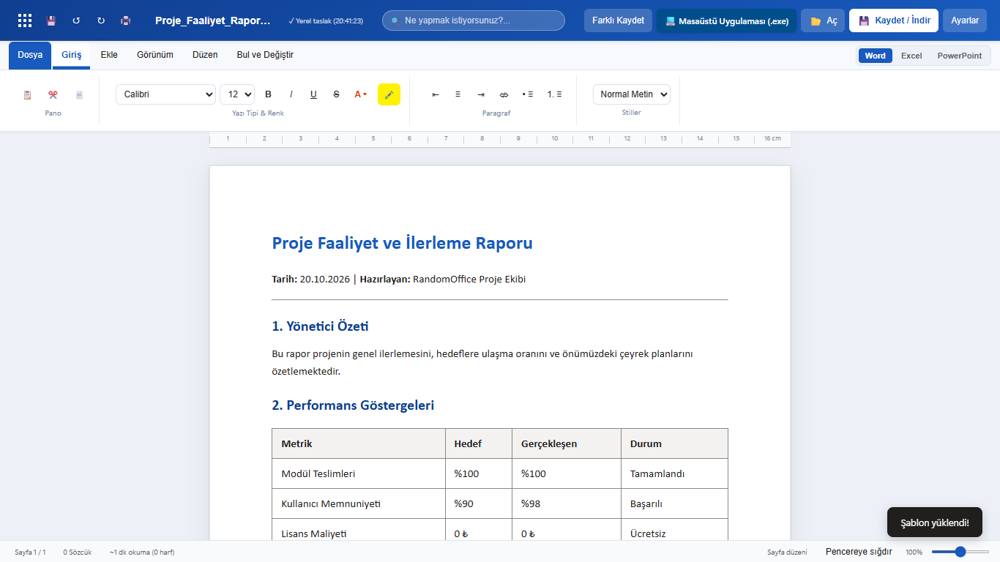
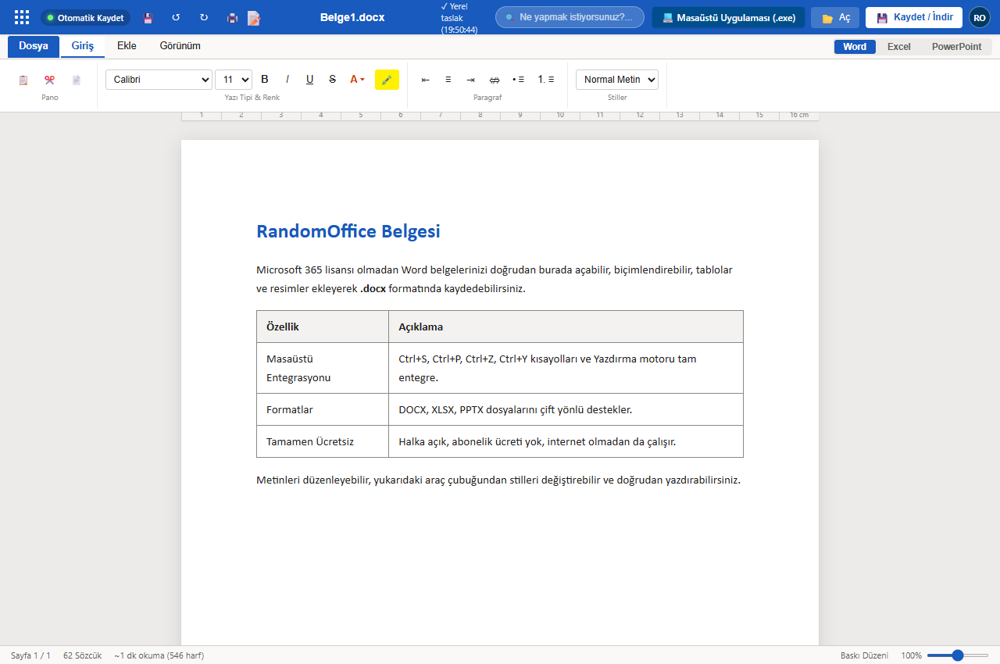
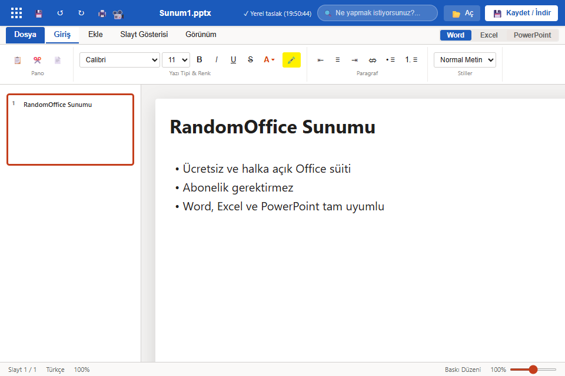
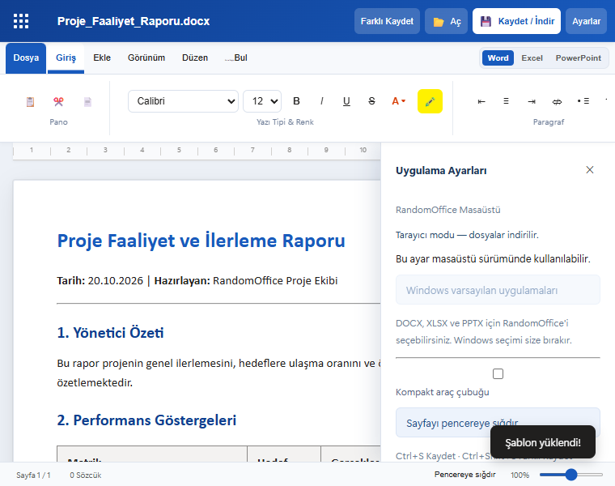

# 🏢 RandomOffice

> **Ücretsiz, hafif ve yerel Masaüstü & Web Office Süiti.** Word (`.docx`), Excel (`.xlsx`) ve PowerPoint (`.pptx`) belgelerini lisans ücreti ödemeden açın, düzenleyin ve kaydedin.

[](https://github.com/memikkizik/randomoffice/actions/workflows/ci.yml)
[]()
[](LICENSE)
[]()
[]()

---

## 📸 Arayüz Galerisi

| 📝 Word (Belge Düzenleyici) | 📊 Excel (Tablo & Formüller) |
| :---: | :---: |
|  |  |
| **📽️ PowerPoint (Sunum & Slaytlar)** | **⚙️ Ayarlar & Kompakt Görünüm** |
|  |  |

---

## ⚡ Hızlı Başlangıç

### 1. Masaüstü Uygulaması (Önerilen)
Windows üzerinde konsol penceresi olmadan doğrudan çalıştırmak için:
- 👉 **`Launch_RandomOffice.vbs`** dosyasına çift tıklayın.

Veya terminal üzerinden:
```powershell
git clone https://github.com/memikkizik/randomoffice.git
cd randomoffice
uv sync
uv run randomoffice desktop
```

### 2. Web Tarayıcısı Modu
```powershell
uv run uvicorn randomoffice.api.app:app --host 127.0.0.1 --port 8000
```
Tarayıcınızda açın: **[http://127.0.0.1:8000](http://127.0.0.1:8000)**

---

## 🎯 3 Temel Uygulama

| Uygulama | Format | Öne Çıkan Özellikler |
| :--- | :---: | :--- |
| **📝 Word** | `.docx` | Zengin metin biçimlendirme, başlık stilleri, tablo & resim ekleme, A4 baskı düzeni, cetvel, canlı kelime sayacı ve Ctrl+P yazdırma. |
| **📊 Excel** | `.xlsx` | Çoklu çalışma sayfaları (`Sayfa1`, `Sayfa2`), formül çubuğu (`fx`), koordinatlar (`A1`), dinamik motor (`SUM`, `AVG`, `MIN`, `MAX`), para & yüzde formatı. |
| **📽️ PowerPoint** | `.pptx` | Slayt kartları, slayt çoğaltma/silme, renk temaları, resim yerleştirme ve **F5 Tam Ekran Slayt Gösterisi** modu. |

---

## ⚖️ Neden RandomOffice?

| Özellik | 🏢 RandomOffice | 💼 Microsoft 365 | 🐧 LibreOffice | 🌐 Google Docs |
| :--- | :---: | :---: | :---: | :---: |
| **Fiyat** | **%100 Ücretsiz** | Yıllık 2.000+ ₺ | Ücretsiz | Ücretsiz |
| **Gizlilik** | **Sıfır Telemetri (Tamamen Yerel)** | Bulut telemetrisi | Yerel | Bulut kaydı |
| **Hesap / Giriş** | **Gerekmez** | Zorunlu | Gerekmez | Zorunlu |
| **Boyut & Hız** | **Hafif (~25 MB) & Hızlı (WebView2)** | 4 - 8 GB (Ağır) | ~550 MB | Web bağımlı |
| **Güvenlik Duvarı** | **Sıfır TCP Soketi (Engellenmez)** | Standart | Standart | Web portları |

---

## ⌨️ Klavye Kısayolları

| Kısayol | İşlev | Uygulama |
| :--- | :--- | :--- |
| <kbd>Ctrl</kbd> + <kbd>S</kbd> | Belgeyi yerinde / farklı kaydet | Tümü |
| <kbd>Ctrl</kbd> + <kbd>P</kbd> | Canlı A4 yazdırma önizlemesi ve yazdır | Tümü |
| <kbd>Ctrl</kbd> + <kbd>B</kbd> / <kbd>I</kbd> / <kbd>U</kbd> | Kalın / İtalik / Altı Çizili | Word |
| <kbd>F5</kbd> / <kbd>Esc</kbd> | Slayt gösterisini başlat / çık | PowerPoint |
| <kbd>→</kbd> / <kbd>←</kbd> | Sonraki / Önceki slayt | PowerPoint |
| <kbd>Enter</kbd> / <kbd>Tab</kbd> | Hücre girdisini onayla ve ilerle | Excel |

---

## 🔒 Güvenlik & Gizlilik İlkeleri

- **Sıfır Telemetri:** Hiçbir veri, analitik veya belge içeriği harici sunuculara aktarılmaz. 100% hava boşluklu (air-gapped) çalışır.
- **Sıfır Güvenlik Duvarı Engeli:** Masaüstü modu in-process WebView2 köprüsü kullanır; Defender Güvenlik Duvarı ağ uyarısı vermez.
- **Sıfır Gizli Anahtar & Tamamen Açık Kaynak:** Kod tabanında hiçbir API gizli anahtarı, sızıntı veya özel arka kapı bulunmaz.

---

## 🧪 Testler

```powershell
powershell -ExecutionPolicy Bypass -File scripts/check_project.ps1 -Scope All
```
*Tüm 207 test (%100 başarı) motor, API ve Playwright tarayıcı senaryolarını kapsar.*

---

## 🤝 Katkıda Bulunma & Lisans

Katkıda bulunmak ve topluluk kurallarımızı incelemek için:

- [**Katkı Kılavuzu**](.github/CONTRIBUTING.md)
- [**Güvenlik Politikası**](.github/SECURITY.md)
- [**Davranış Kuralları**](.github/CODE_OF_CONDUCT.md)
- [**MIT Lisansı**](LICENSE)
